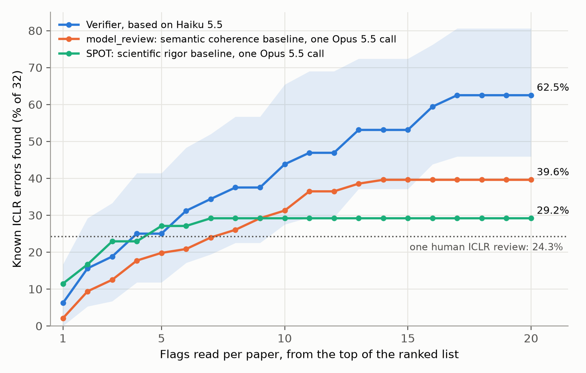
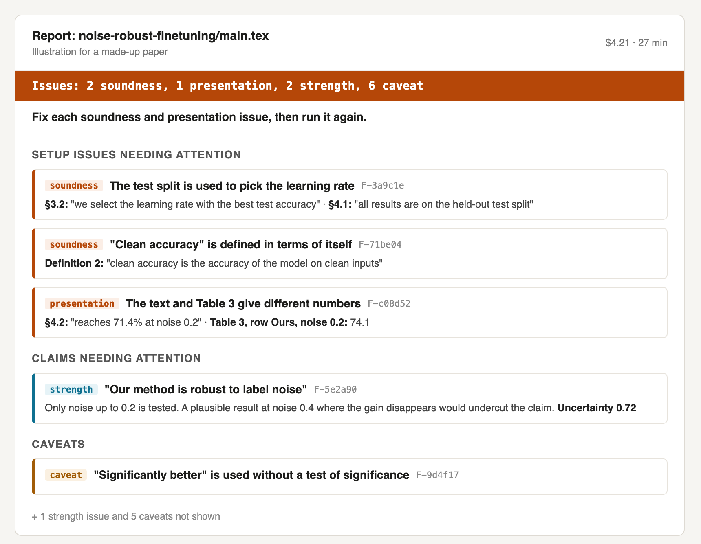
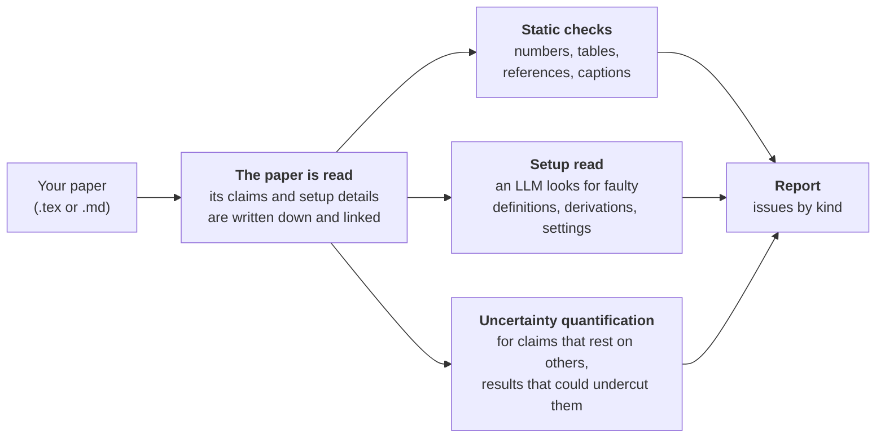

# Verifier

The Verifier checks a research project for mistakes, flagging issues like numerical 
inconsistencies between the paper text and the corresponding tables, or claims not fully 
supported by the results. 

The Verifier can check an existing paper in 10 to 25 minutes,
and can continually check your ongoing project's codebase as you or your agent work 
on it.

[Quickstart](#quickstart) | [Your data](#your-data) |
[Read the report](#read-the-report) | [All commands](docs/USAGE.md) |
[Full documentation](https://verifier.meno.sh/)

## Quickstart

You need macOS or Linux, [uv](https://docs.astral.sh/uv/), git 2.28 or later, curl (and
unzip on macOS), and an [OpenRouter](https://openrouter.ai) API key with credit.

```bash
git clone https://github.com/meno-sh/Verifier.git
cd Verifier
./install.sh
export OPENROUTER_API_KEY=...
```

If `verifier` is not found after install, run `uv tool update-shell` once and open a new
terminal.

**Check existing papers or projects** in your browser:

```bash
verifier web      # opens http://127.0.0.1:8765/
```

Upload the paper's `.tex` or `.md` files (up to 1 GB), or a `.zip` of its source 
and optionally code/data (up to 4 GB). The report appears on the page when the check is done.

A first full check of a usual paper costs about $5 to $15 and takes 10 to 25 minutes, paid
to OpenRouter directly.

> [!NOTE]
> Treat flags as leads for you to check instead of proven errors.

**Watching over and continually checking an ongoing project as you develop it** (Beta):

```bash
cd /path/to/project                        # git repository with at least one commit
verifier start . --claims-from results.md  # supports .md and .tex files
```

It incrementally updates its verification report whenever you make a commit.

> [!WARNING]
> Support for the watchover mode is experimental. See [docs/USAGE.md](docs/USAGE.md).

## When to use it

- **Before you post to arXiv or submit.** Run a full check on the final source.
- **After a big rewrite.** Rerun the check to flag new problems.
- **As you (or your agents) are working.** Let the Verifier help audit the claims that your
  agents are making to you.

## What it catches and what it misses

It catches:

- **Errors in the setup:** a circular, missing or vague definition, a derivation step that
  does not follow, a dataset size or hyperparameter that differs between sections, a
  baseline that does not test what its name says, a number in the text that differs from
  a table.
- **Claims the results do not fully support:** a claim that the paper does not fully
  support, a claim that a possible follow-up experiment can break, or a claim that rests on
  itself through other claims.

It misses:

- **A wrong number that the paper reports the same way everywhere.** The Verifier only
  reads the paper, so it has nothing to compare the number with.
- **Problems in your code or data.** Checking code and data is not supported yet.
- **Errors in figures.** The Verifier reads the source text and tables, not images.
- **Whether the work is novel or important.** It checks what the paper says, not whether
  it is worth saying.

### Test results on 19 papers

In November 2026 we tested the Verifier on 19 ICLR papers. Reviewers of these papers reported
32 errors, and the authors accepted them. We call them the known errors. We compared the
Verifier with two baselines. Each baseline is one Opus 5.5 call with one review prompt:

- **`model_review`** is our prompt. It checks if the claims of the paper follow from what
  the paper did and measured.
- **SPOT** is the prompt of the published SPOT benchmark
  ([Son et al., 2025](https://arxiv.org/abs/2505.11855)). It checks scientific rigor.

<p align="center">
  
  <br><sub>Each line is one reviewer. The x axis is the number of flags that you read for each
  paper. The y axis is the share of the 32 known errors that these flags find. The dotted line
  is the share that one human ICLR review found. The shaded band is the 95% interval of the
  Verifier.</sub>
</p>

> [!NOTE]
> We used an internal validation set to develop the Verifier. It is a validation set, not a
> training set. This validation set overlaps with these 19 papers. So these results can
> potentially be overoptimistic compared to results on new papers. We are working on a
> more rigorous test set.

For the method, the full table and the limits, see
[Test results](https://verifier.meno.sh/results.html).

## Your data

- **A full check sends your paper's text** to the models (Claude and Kimi) through
  OpenRouter. The agent can also open other files in the folder or `.zip` you give it,
  so their contents may be sent too.
- **Results stay on your computer.** A check from the terminal writes to `.verifier/`
  inside the project. A check on the browser page stays in
  `~/.local/share/verifier/web-runs/` until you delete it. The page itself is only
  reachable from your own computer.
- **The auditing agent can read your files and keys.** The agent runs as your user
  account. It can read each file that your account can read. This includes key files
  in the project, such as `credentials.json`, and the API key that the Verifier uses.
  Run the Verifier only on projects that you trust.
- **Set a spending limit on your OpenRouter key.** Make a key for the Verifier only,
  and set a credit limit on it in OpenRouter, above the cost of a check (see
  "Quickstart" above), for example $25. A watched project checks each new commit
  again, so the cost can repeat.

## Read the report

Every issue in the report has one of six kinds. The kind tells you how much it matters
and what to do about it:

<p align="center">
  
</p>

Here is what a report looks like. The bar at the top counts the issues of each kind, and
the line under it says what to do next. The flags follow in three groups: problems in the
setup, claims that need attention, and caveats. Each flag quotes the text it is about, so
you can find it in your paper, and has an id (such as `F-3a9c1e`) that you can use to
[dispute it](docs/USAGE.md#when-a-flag-is-wrong).

<p align="center">
  
  <br><sub>An illustration of a report, for a made-up paper.</sub>
</p>

Read each flag against your paper before you act on it. Some flags will be wrong. If one
is, dispute it on the page or with `verifier dispute`. The developers use disputes to make
the checks better (see [docs/USAGE.md](docs/USAGE.md#when-a-flag-is-wrong)).

## How it works



A claim is a result the paper states, such as "our method gets 71% accuracy". The setup
is everything the results depend on: definitions, data, models and settings. Uncertainty
quantification takes each claim that rests on other claims, writes results a follow-up experiment
could plausibly find, scores how much each would break the claim, and flags the claim if the
worst believable result, or the claim with no result against it, scores above 0.59.

> [!CAUTION]
> A full check runs an agent (Kimi K3). It can open files and run commands inside the
> folder it checks. Only check folders you are happy for it to read.

## Update and uninstall

- **Update:** run `git pull` in the `Verifier` folder, then `./install.sh` again. Restart
  `verifier web` and any running check to use the new version.
- **Uninstall:** in each project you checked from the terminal, run `verifier uninstall .`
  to remove its git hook, and delete its `.verifier/` folder. Then run
  `uv tool uninstall verifier`, and delete `~/.local/share/verifier/` and the `Verifier`
  folder you cloned.

## More documentation

The full documentation is at [meno.sh/verifier](https://meno.sh/verifier/). It explains how the
Verifier reads a paper and how uncertainty quantification works.

[docs/USAGE.md](docs/USAGE.md) has the main commands and options, how to check a paper from the
terminal, how to dispute a flag, and where the Verifier keeps its files.

## License

The code is under the MIT license. See [LICENSE](LICENSE).
